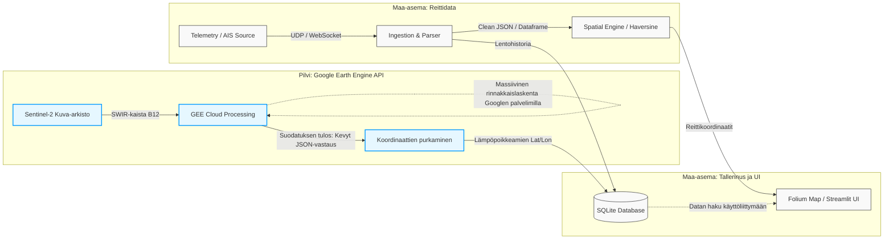
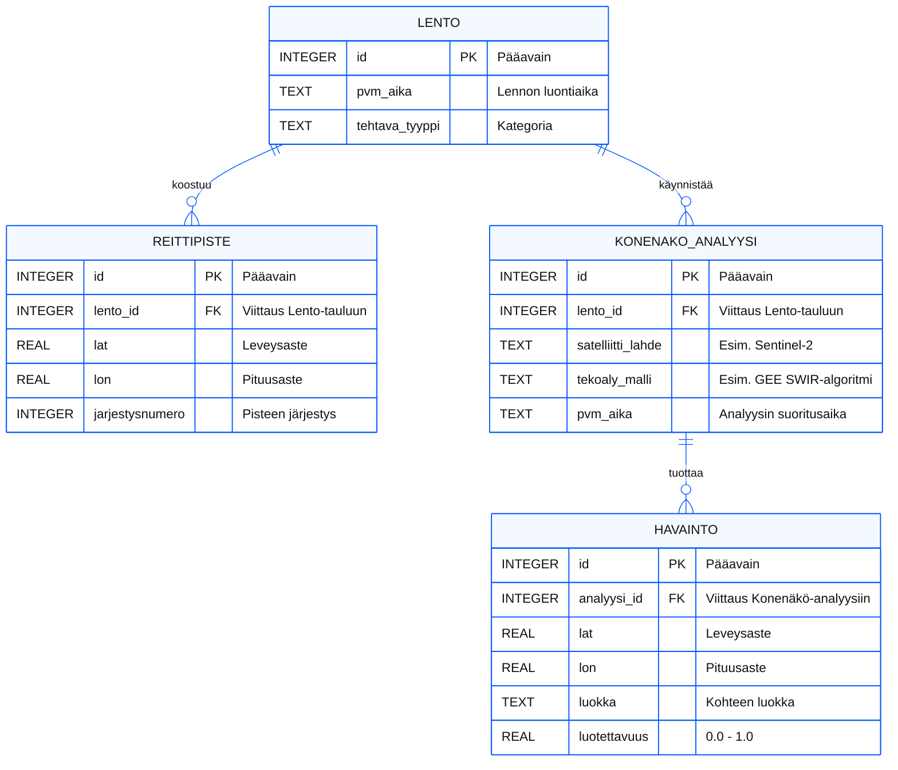

# UAS AI Ground Control Station 

Tämä projekti on modulaarinen maa-asemaohjelmiston demo.  Järjestelmä yhdistää droonin reaaliaikaisen telemetrian ja tekoälypohjaisen konenäön (IMINT) yhtenäiseksi tilannekuvaksi.

## Arkkitehtuuri ja moduulit

Rakennettu aikaisemman Rottendam seurannan opettaman arkkitehtuurinn päälle pienillä muokkauksilla 
Projekti on jaettu selkeisiin moduuleihin, jotta raskas kuva-analyysi ei jäädytä kriittistä paikkatietodataa kun analysointiin kuluu liikaa aikaa. 

Järjestelmä koostuu seuraavista osista:

* **app.py (Käyttöliittymä)**: Streamlitillä ja Foliumilla toteutettu visuaalinen kojelauta. Vastaa lentoreittien suunnittelusta, kartan piirtämisestä ja datan esittämisestä käyttäjälle.
* **telemetry.py (Tietoliikenne)**: Vastaa datan vastaanotosta. Lukee Pymavlink-kirjaston avulla droonin tai SITL-simulaattorin lähettämää raakadataa (kuten GPS-koordinaatit ja akun tila).
* **vision.py (Konenäkö)**: Käsittelee kamerasyötteen. Simuloi raskaiden tekoälymallien (esim. LandCover.ai) toimintaa analysoimalla maastoa ja palauttamalla havainnot käyttöliittymälle.
* **database.py (Tietokanta)**: Paikallinen SQLite-tietokanta, johon tallennetaan suunnitellut reittipisteet, lentolokit sekä tekoälyn tekemät havainnot tarkkoine koordinaatteineen myöhempää raportointia varten.

## Teknologiat joita käytetään
* Kieli: Python
* Käyttöliittymä: Streamlit, streamlit-folium
* Paikkatieto ja analyysi: Folium, Pandas
* Drooni-integraatio: Pymavlink, SITL

#Tietokantarakenteen hahmotelma:

